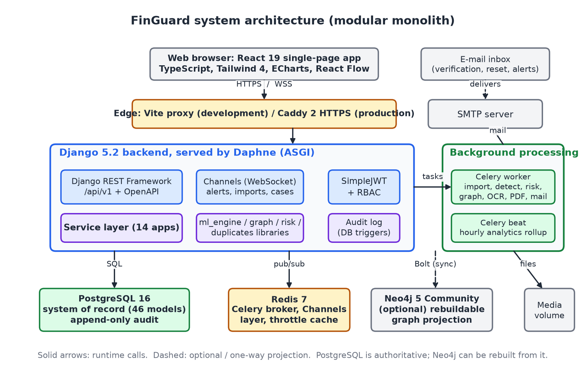
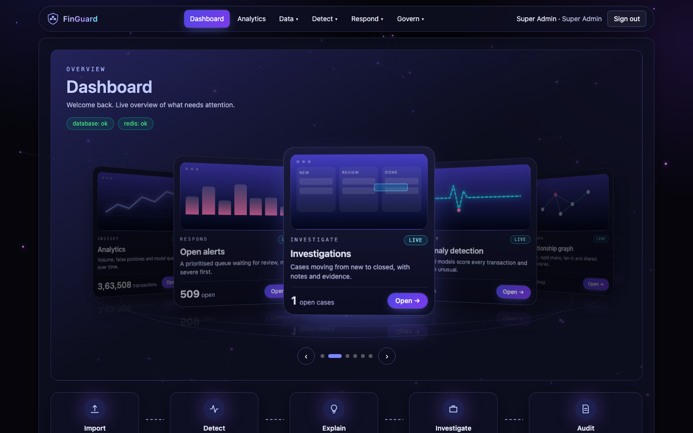
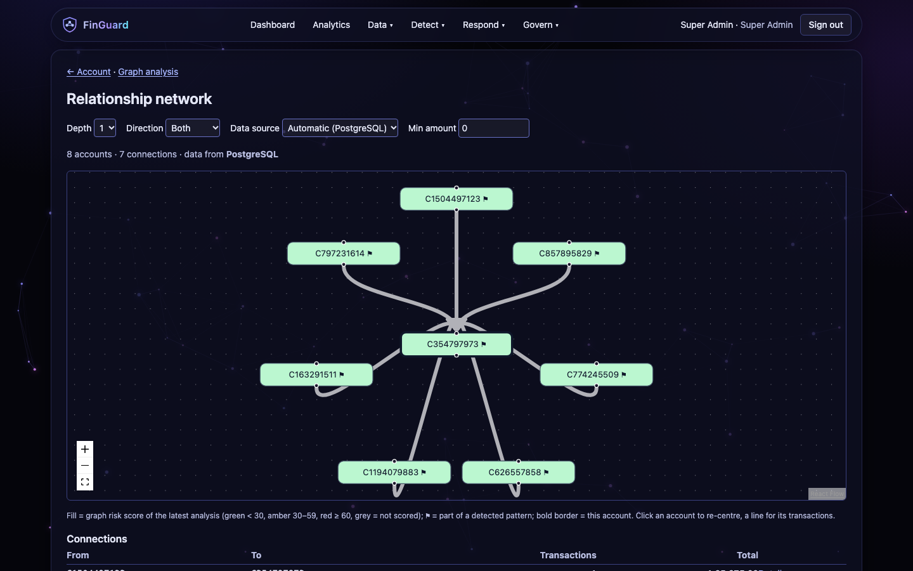
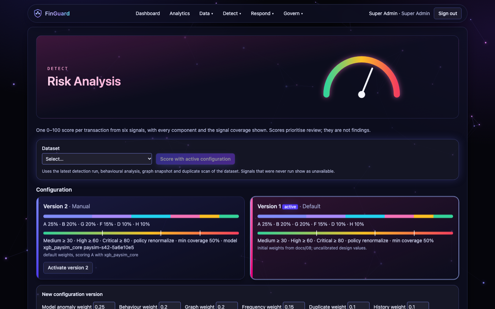
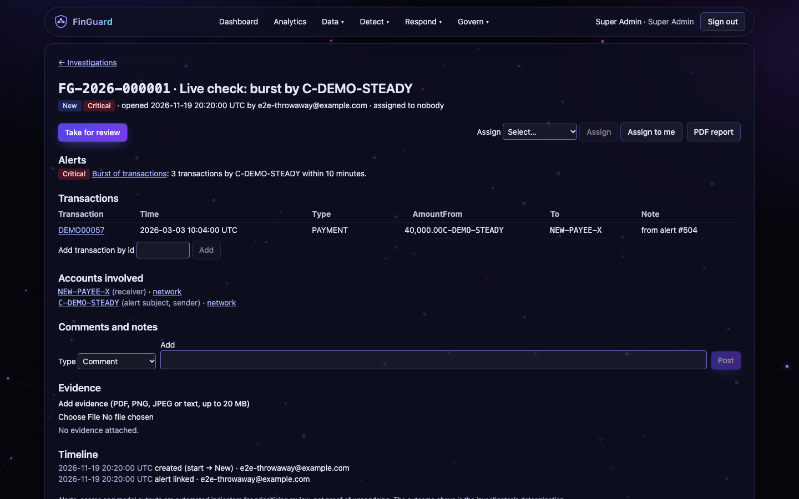
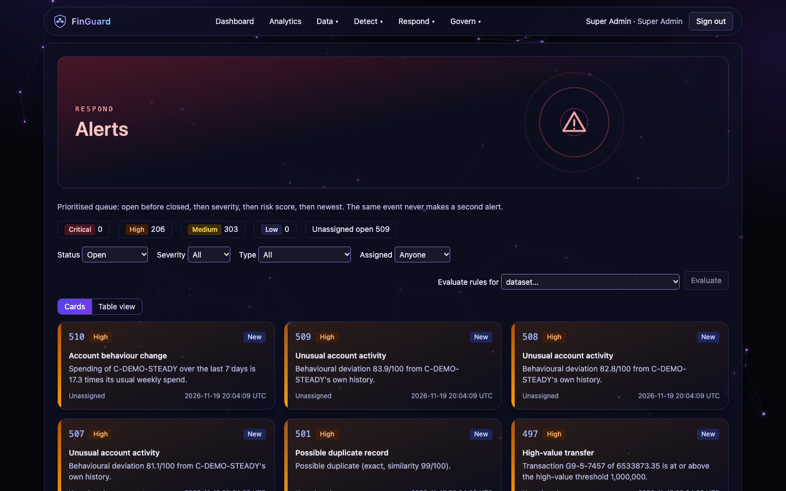
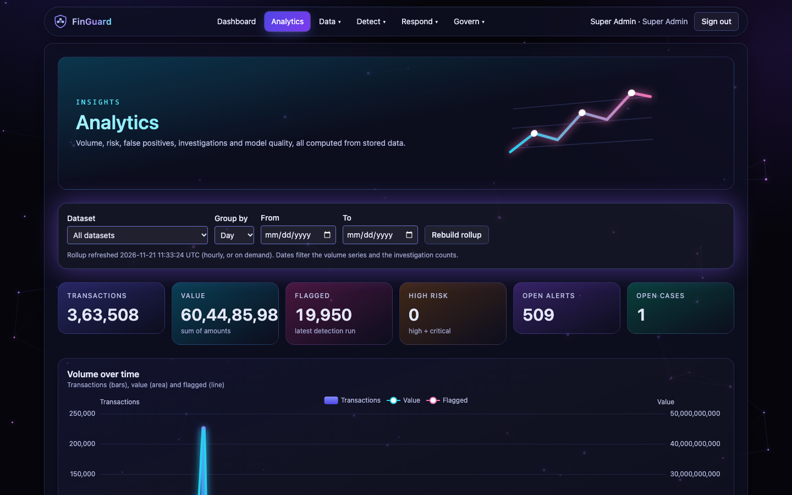

# FinGuard

<p align="center">
  
</p>

<p align="center">
  <strong>An Intelligent Financial Anomaly Detection and Transaction Investigation System using Machine Learning, Graph Analytics and Explainable AI.</strong>
</p>

<p align="center">
  
  
  
  
  
  
  
  
  
  
  
</p>

---

## Executive Summary

**FinGuard** is an end-to-end financial intelligence platform that monitors high-volume transactions, flags anomalies, explains *why* transactions were flagged using Explainable AI (SHAP / LIME), detects complex multi-party laundering structures via graph networks, and supports human fraud teams through prioritized alert triage and case management.

Built as an enterprise-grade modular monolith, FinGuard bridges the gap between raw data-science experiments and investigator-centric operations. It is accompanied by an extensive **53-page IEEE-style Project Report (SRS)** with full diagrams and benchmarks (available in [report/Project_Report_Final.pdf](report/Project_Report_Final.pdf) and [report/Project_Report_Final.docx](report/Project_Report_Final.docx)).

> **Design Principle:** FinGuard never autonomously convicts a transaction or account. Automated machine-learning models and graph heuristics generate *risk indicators and review alerts*; authorized human investigators retain final decision authority. The data architecture strictly isolates model predictions, anomaly indicators, forensic evidence, investigator assessments, and final disposition outcomes.

> **Data Scope:** Academic prototype evaluated against public and synthetic financial datasets (PaySim mobile money, ULB credit card fraud, Elliptic Bitcoin). It does not interface with live consumer bank accounts.

---

## Core Capabilities & System Modules

FinGuard provides a complete pipeline from ingestion to case resolution:

| # | Module | Capabilities & Implementation |
|---|---|---|
| 1 | **Transaction Monitoring & Ingestion** | Bulk CSV and Excel ingestion with custom column mapping, validation, duplicate-ID handling, live progress tracking via Celery/WebSockets, streaming error reports, and full audit logging. |
| 2 | **ML Anomaly Detection** | 7 evaluated supervised & unsupervised algorithms (Logistic Regression, Random Forest, XGBoost, Isolation Forest, Local Outlier Factor, One-Class SVM, Autoencoder). Model registry with hash-verified artifact loading, version tracking, and offline performance evaluations (PR-AUC, ROC-AUC, F1). |
| 3 | **Behavioral & Spending Pattern Analysis** | Point-in-time (*as-of*) account profiles, rolling behavioral baselines, temporal velocity tracking, and robust deviation scoring across transaction amount, frequency, and time-of-day. |
| 4 | **Graph Relationship & Network Analytics** | Account-to-account transaction graph engine powered by NetworkX with an idempotent Neo4j projection. Detects laundering typologies: circular funds routing (cycles), rapid transit chains, fan-in/fan-out structuring, and shared beneficiaries. |
| 5 | **Duplicate Detection & Invoice OCR** | Exact and fuzzy matching of duplicate payments, invoice PDF/image upload with automated Tesseract OCR field extraction, perceptual image hashing, Levenshtein distance matching, human review workflow, and downloadable PDF reports. |
| 6 | **Alert Engine & Prioritized Triage** | 9 configurable deterministic and heuristic alert rule types, automated deduplication, alert lifecycle (acknowledge, assign, escalate, close), real-time WebSocket push notifications, and asynchronous SMTP email dispatch. |
| 7 | **Multi-Signal Risk Scoring** | Configurable weighted risk engine: $$R = 0.25A + 0.20B + 0.20G + 0.15F + 0.10D + 0.10H$$. Explicit missing-signal policies with signal coverage tracking (scores with low coverage are capped to prevent false certainty). |
| 8 | **Explainable AI (XAI)** | Local prediction explanations via exact TreeSHAP / KernelSHAP and LIME, global feature importance charts, deterministic human-readable forensic narratives, version-bound explanation staleness checks, and downloadable PDF explanation briefs. |
| 9 | **Case Management & Investigations** | Validated 6-state case lifecycle (*Under Review* &rarr; *Investigation* &rarr; *Escalated* &rarr; *Resolved* &rarr; *Closed*), immutable revision-tracked notes, SHA-256 hashed forensic evidence attachments, audit trail, and formal case resolution reports. |
| 10 | **Analytics & Reporting** | Daily aggregate rollups, 10 read-optimized metrics endpoints, dynamic interactive 3D visualizations (ECharts-GL), false-positive tracking, investigator resolution metrics, and injection-safe CSV and PDF report exports. |
| 11 | **Self-Service Accounts & Governance** | Public self-service registration, automated tokenized email verification, self-service password reset, administrative approval queue with RBAC role assignment, default-deny endpoint authorization, and PostgreSQL append-only audit trigger. |

---

## Architecture & Technology Stack

FinGuard follows a **modular monolith** design where core business logic, orchestration, and APIs reside in Django, while machine learning, graph detection, and risk scoring are decoupled into pure-Python libraries executed asynchronously by Celery workers.

```
React 18 + TypeScript SPA ──REST / WebSocket──► Django 5.2 (DRF + Channels)
                                                     │
               ┌───────────────┬─────────────────────┼─────────────────────┐
          PostgreSQL 16      Redis 7               Neo4j 5             Media Storage
       (System of Record) (Celery Broker,        (Rebuildable        (Uploads, Invoices,
                           Cache, Channels)      Graph Copy)          Model Artifacts)
                                                     ▲
                                         Celery Workers (Async)
                              (Imports, Scoring, Graph, OCR, Reports, Mail)
```

### Technology Highlights

- **Frontend:** React 18, Vite, TypeScript (strict mode), Tailwind CSS, TanStack Query, React Router v6, React Hook Form + Zod, Apache ECharts & ECharts-GL (3D visualizations), `@xyflow/react` (interactive graph visualization), Lucide icons.
- **Backend:** Python 3.12, Django 5.2, Django REST Framework, Django Channels (WebSockets via ASGI/Daphne), SimpleJWT (rotating httpOnly refresh cookies), drf-spectacular (OpenAPI 3.0 / Swagger).
- **Asynchronous & Caching:** Celery, Redis 7 (channel layer and task broker).
- **Databases:** PostgreSQL 16 (authoritative system of record with append-only audit triggers), Neo4j 5 Community / Aura (rebuildable graph projection).
- **Machine Learning & Graph:** scikit-learn, XGBoost, PyTorch, pandas, NumPy, NetworkX, SHAP, LIME.
- **Computer Vision & OCR:** Tesseract OCR (`tesseract-ocr`, `pytesseract`, `Pillow`, `pypdfium2`, `rapidfuzz`, `imagehash`, `reportlab`).
- **Production & Security:** Caddy web server (automatic HTTPS, reverse proxy), Docker Compose, OWASP top-10 security validation, Playwright browser test suite.

---

## Role-Based Access Control (RBAC)

FinGuard enforces a **default-deny** security policy across all endpoints:

| Role | Operational Scope |
|---|---|
| **Super Admin** | Full platform administration: user approvals, role assignments, risk threshold tuning, model registration, audit inspection. |
| **Financial Analyst** | Ingestion, transaction monitoring, running detection/behavior/graph/risk jobs, alert triage, opening investigation cases. |
| **Fraud Investigator** | Alert review, full case workflow management, evidence upload, notes recording, XAI explanation review, case closure. |
| **Auditor** | Read-only compliance visibility across all investigations, transactions, accounts, and immutable audit logs. |
| **Management** | Strategic oversight: executive dashboard, operational analytics, model performance tracking, CSV/PDF report exports. |

---

## System Verification & Quality Metrics

FinGuard is fully implemented, verified, and backed by a comprehensive automated test suite and security validation:

| Verification Category | Validation Scope | Status | Result / Metrics |
|---|---|---|---|
| **Backend Testing** | Unit, integration, service layer, and RBAC matrix | ✅ Passed | 404 automated tests (**88% code coverage** via `pytest-cov`) |
| **Frontend Testing** | UI component tests, schema validation, state stores | ✅ Passed | 90 tests (`vitest` + React Testing Library) |
| **Browser E2E Testing** | Multi-role user journeys, accessibility, and responsiveness | ✅ Passed | 35 specs (`Playwright` isolated profile) |
| **Code Quality & Typing** | Linting and strict static type checking | ✅ Clean | Clean passes on `ruff`, `mypy` (strict), and `tsc -b` |
| **Security Auditing** | OWASP Top-10 mapping, injection guards, N+1 query limits | ✅ Verified | Enforced default-deny RBAC, append-only audit trigger ([Report](docs/20-PHASE15-TEST-SECURITY-PERFORMANCE-REPORT.md)) |
| **Production Readiness** | Container orchestration, TLS, and automated backups | ✅ Rehearsed | Production Compose, Caddy HTTPS, backup & restore drill ([Guide](docs/14-DEPLOYMENT-GUIDE.md)) |
| **Documentation & SRS** | IEEE-style Software Requirements Specification | ✅ Complete | 53-page report with diagrams & screenshots in [report/](report/) |

---

## UI Showcase

The application features a modern dark-glass interface designed for high-density forensic analysis:

| Dashboard & Overview | Relationship Graph Analytics |
|:---:|:---:|
|  |  |
| *Executive dashboard with 3D charts and real-time alert feeds* | *Network graph uncovering cycles, chains, and fan-in structures* |

| Risk Analysis Breakdown | Case Management & Investigations |
|:---:|:---:|
|  |  |
| *Multi-signal risk score composition and coverage gauges* | *Formal case workflow, SHA-256 hashed evidence, and timeline* |

| Alert Management Queue | Operational Analytics |
|:---:|:---:|
|  |  |
| *Prioritized triage queue with lifecycle actions* | *Volume trends, false-positive metrics, and resolution stats* |

*(More screenshots available in [`report/screens/`](report/screens/))*

---

## Getting Started

FinGuard runs entirely in containerized environments. You do **not** need to install Python, Node, PostgreSQL, or Neo4j locally.

### 1. Prerequisites
- **Docker Desktop** installed and running (`docker info` must succeed).
- Allocate at least 6–8 GB RAM to Docker in Docker Desktop Settings.
- **Important macOS note:** Keep the project folder outside iCloud-synced directories (e.g. avoid `~/Desktop` or `~/Documents` if iCloud Drive sync is enabled to prevent file I/O latency).

### 2. Environment Configuration
Clone the repository and copy the example environment configuration:
```bash
git clone https://github.com/Ajayrazz/FINGUARD-Intelligent-Financial-Anomaly-Detection-and-Transaction-Investigation-System.git
cd FINGUARD-Intelligent-Financial-Anomaly-Detection-and-Transaction-Investigation-System

cp .env.example .env
```
Edit `.env` and configure your secure passwords for `DJANGO_SECRET_KEY`, `POSTGRES_PASSWORD`, and `NEO4J_PASSWORD`.

### 3. Build & Launch Containers
Start the development stack:
```bash
docker compose up -d --build
```
This builds and starts:
- `db` (PostgreSQL 16) on port `5432`
- `redis` (Redis 7) on port `6379`
- `neo4j` (Neo4j 5 Community) on ports `7474` (browser) and `7687` (Bolt)
- `backend` (Django 5.2 / Daphne ASGI) on port `8000`
- `worker` (Celery background worker)
- `frontend` (React 18 / Vite SPA) on port `5173`

### 4. Database Migrations & Initial Super Admin
Run database migrations and create your administrative account:
```bash
docker compose exec backend python manage.py migrate
docker compose exec backend python manage.py create_superadmin --email admin@example.com
```
*(Enter a secure password of at least 12 characters when prompted)*

### 5. Access the Platform
- **Web Application:** [http://localhost:5173](http://localhost:5173)
- **Interactive API Documentation (Swagger / OpenAPI):** [http://localhost:8000/api/docs/](http://localhost:8000/api/docs/)
- **System Health Checks:** [http://localhost:8000/api/v1/health/](http://localhost:8000/api/v1/health/) and `/api/v1/health/ready/`

---

## Seeding Synthetic & Demo Data

To populate the system with demonstrative scenarios:

```bash
# 1. Seed 10,000 synthetic transactions across 1,000 accounts
docker compose exec backend python manage.py seed_mock_transactions --rows 10000 --accounts 1000

# 2. Seed a behavioral deviation scenario (sudden burst / cold-start spending anomalies)
docker compose exec backend python manage.py seed_behavior_scenario

# 3. Seed a complex money-laundering graph scenario (circular routing, rapid chains, fan-in/fan-out)
docker compose exec backend python manage.py seed_graph_scenario

# 4. Generate synthetic invoices for duplicate & OCR testing
docker compose exec backend python manage.py generate_synthetic_invoices --email admin@example.com
```

---

## Daily Operations & Commands

```bash
# Start all services
docker compose up -d

# Stop all services (preserves database and cache volumes)
docker compose stop

# Restart backend and Celery worker after backend code modifications
docker compose restart backend worker

# Follow real-time service logs
docker compose logs -f backend
docker compose logs -f worker
docker compose logs -f frontend

# CAUTION: 'docker compose down -v' will permanently purge database volumes
```

### Email Notifications
In development, outgoing transactional emails (account verification, password reset, alert dispatches) are printed directly to the Celery worker log:
```bash
docker compose logs worker --since 10m
```
To enable live SMTP delivery via Gmail or corporate mail servers, specify `EMAIL_HOST`, `EMAIL_HOST_USER`, `EMAIL_HOST_PASSWORD`, and `EMAIL_PORT` in your `.env` file.

---

## Running Verification & Test Suites

Execute full validation suites matching our CI pipeline:

```bash
# Backend linter and static typecheck
docker compose exec backend ruff check .
docker compose exec backend mypy .

# Backend automated test suite (404 tests)
docker compose exec backend pytest -q

# Frontend static typecheck, linter, and unit tests (90 tests)
docker compose exec frontend sh -c "npx tsc -b && npm run lint && npm test"

# End-to-end browser tests via Playwright (35 specs)
docker compose --profile e2e up -d
docker compose exec backend-e2e python manage.py seed_e2e
npm --prefix e2e test
```

---

## Production Deployment

FinGuard includes a hardened production configuration with automated TLS certificates managed by Caddy:

```bash
# 1. Prepare production environment file
cp .env.prod.example .env.prod

# 2. Launch production stack (Django + Celery + PostgreSQL + Redis + Neo4j + Caddy HTTPS)
docker compose -f docker-compose.prod.yml --env-file .env.prod up -d --build

# 3. Automated backup and restore drills
./scripts/backup.sh              # Backs up PostgreSQL DB and media evidence
./scripts/restore.sh <backup_dir> # Restores state and validates integrity
```
Refer to [docs/14-DEPLOYMENT-GUIDE.md](docs/14-DEPLOYMENT-GUIDE.md) and [docs/24-FREE-DEPLOYMENT-OPTIONS.md](docs/24-FREE-DEPLOYMENT-OPTIONS.md) for full deployment architectures.

---

## Documentation Index

The repository includes comprehensive architectural, algorithmic, and experimental documentation:

| Document | Topic |
|---|---|
| [docs/00-PROJECT-OVERVIEW.md](docs/00-PROJECT-OVERVIEW.md) | High-level project rationale, objectives, and domain context |
| [docs/04-TECHNOLOGY-STACK.md](docs/04-TECHNOLOGY-STACK.md) | In-depth justification of tools, frameworks, and versions |
| [docs/05-SYSTEM-ARCHITECTURE.md](docs/05-SYSTEM-ARCHITECTURE.md) | System architecture diagrams, components, and data flows |
| [docs/06-DATABASE-DESIGN.md](docs/06-DATABASE-DESIGN.md) | Schema specifications, relational models, and Neo4j graph model |
| [docs/07-API-SPECIFICATION.md](docs/07-API-SPECIFICATION.md) | REST and WebSocket API specifications and contracts |
| [docs/08-ML-RESEARCH-AND-METHODOLOGY.md](docs/08-ML-RESEARCH-AND-METHODOLOGY.md) | ML algorithms, feature engineering, and experimental methodology |
| [docs/09-DATASET-STRATEGY.md](docs/09-DATASET-STRATEGY.md) | Dataset ingestion strategy, leakage risks, and partition schemas |
| [docs/10-SECURITY-AND-RBAC.md](docs/10-SECURITY-AND-RBAC.md) | Threat modeling, permission matrix, JWT lifecycle, and audit triggers |
| [docs/12-IMPLEMENTATION-ROADMAP.md](docs/12-IMPLEMENTATION-ROADMAP.md) | Delivery schedule, milestones, and acceptance criteria |
| [docs/14-DEPLOYMENT-GUIDE.md](docs/14-DEPLOYMENT-GUIDE.md) | Production setup, container hardening, and disaster recovery drills |
| [docs/15-DECISION-LOG.md](docs/15-DECISION-LOG.md) | Architecture Decision Records (ADRs) and trade-off analyses |
| [docs/20-PHASE15-TEST-SECURITY-PERFORMANCE-REPORT.md](docs/20-PHASE15-TEST-SECURITY-PERFORMANCE-REPORT.md) | Security audit report, query benchmarks, and NFR verification |
| [docs/21-USER-GUIDE.md](docs/21-USER-GUIDE.md) | End-user walkthrough, investigation workflows, and role guides |
| [docs/22-DEMO-SCRIPT.md](docs/22-DEMO-SCRIPT.md) | Structured presentation script for live evaluators and demos |
| [docs/23-FINAL-EXPERIMENT-REPORT.md](docs/23-FINAL-EXPERIMENT-REPORT.md) | Empirical research results across PaySim and ULB benchmarks |
| [report/README.md](report/README.md) | Full 53-page IEEE-style Project Report (SRS format) in PDF and DOCX |

---

## Research & Legal Disclaimer

FinGuard is a final-year academic and research engineering project. Risk scores, behavioral anomalies, and Explainable AI narratives (SHAP/LIME) generated by the system are probabilistic indicators intended solely to assist human analysts in prioritizing review; they do not constitute legal proof or regulatory determinations of financial criminality.

---

## License

Academic and research engineering project — developed as a final-year project. All rights reserved.
