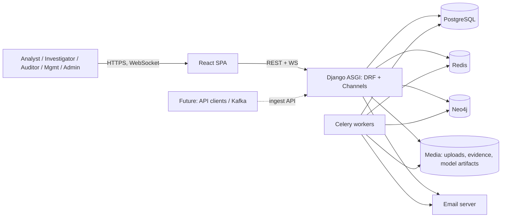
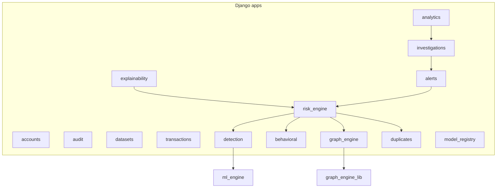
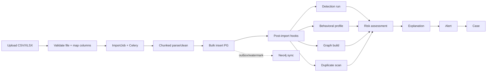
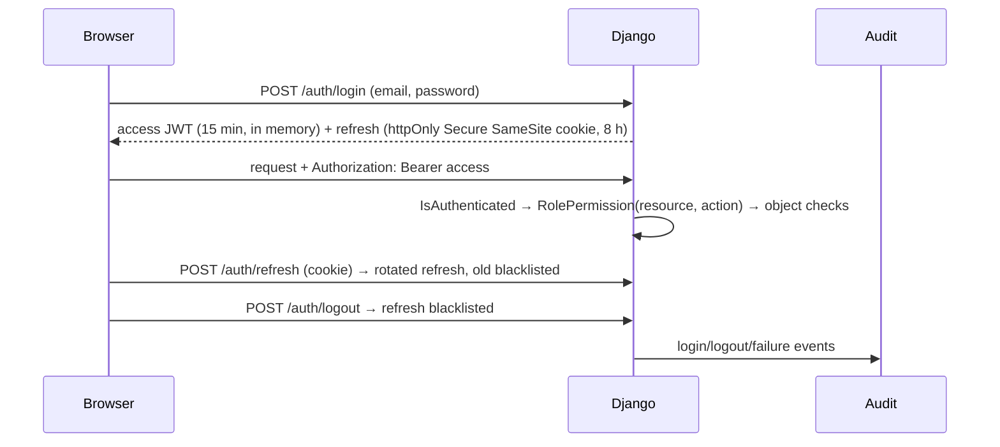
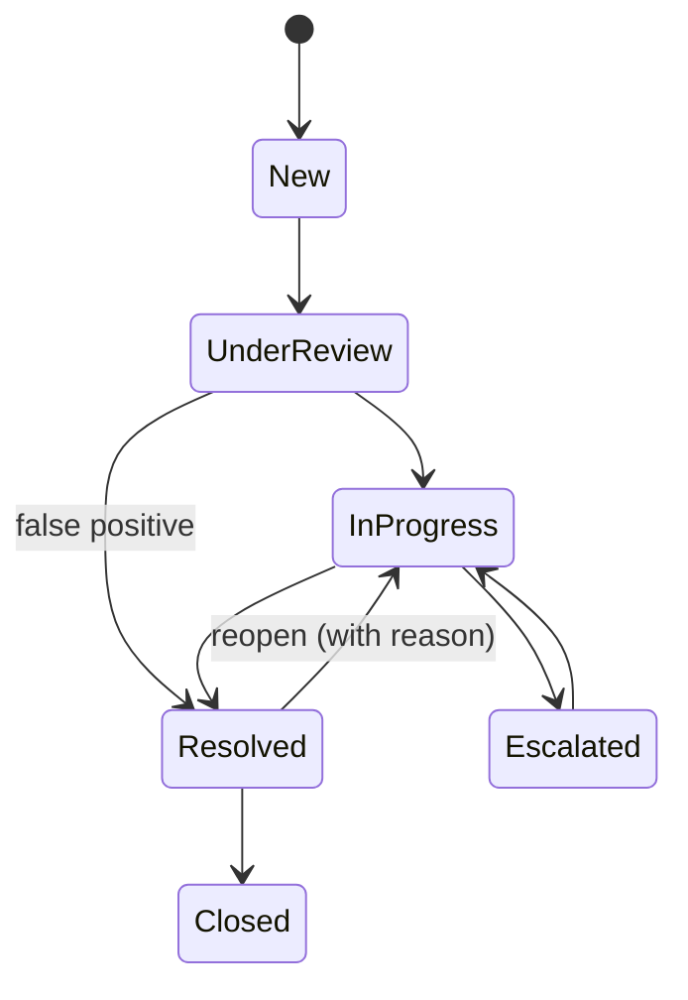
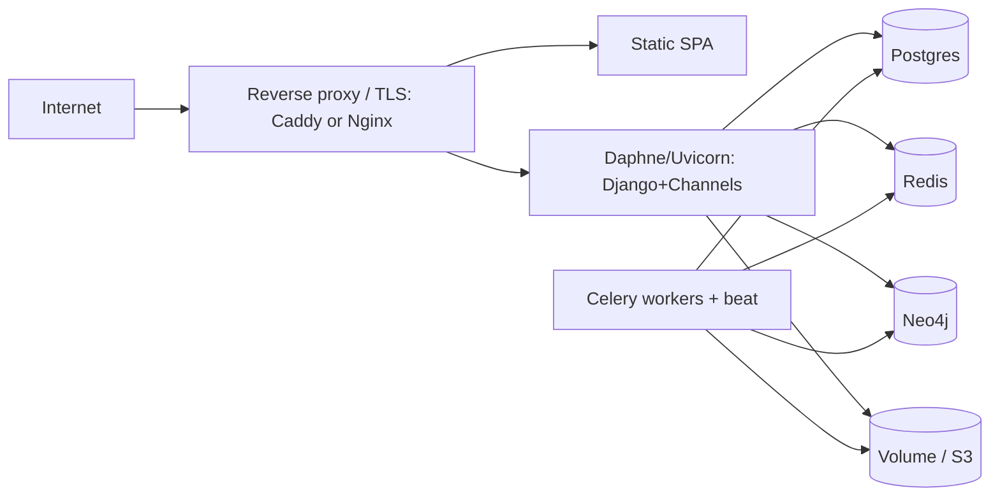

# 05 — System Architecture

Style: **modular monolith** (Django) + independent pure-Python analytical libraries + Celery workers. No microservices (D-003).

## 1. System context


## 2. Backend component architecture
Layering inside each Django app: `api/` (views, serializers, filters, permissions) → `services/` (use-cases, transactions) → `domain/` (pure logic, dataclasses) → `models.py`; `tasks.py` thin wrappers calling services.

Analytical libraries (no Django imports; unit-testable alone):
- `ml_engine/` — `preprocessing/`, `feature_engineering/`, `training/`, `models/`, `evaluation/`, `inference/`
- `graph_engine_lib/` *(renamed from the prompt's `graph_engine/` to avoid clashing with the Django app `apps/graph_engine`; D-004)* — `builders/`, `algorithms/`, `analysis/`

Dependency direction (no cycles; enforced by import-linter):
```
accounts, audit            (foundation; everyone may import audit.log())
datasets → transactions
model_registry
detection → transactions, model_registry, ml_engine
behavioral → transactions
graph_engine → transactions, graph_engine_lib
duplicates → transactions
risk_engine → detection, behavioral, graph_engine, duplicates   (reads their result tables via selectors)
explainability → detection, risk_engine, behavioral, graph_engine, model_registry
alerts → risk_engine, transactions                               (does NOT import investigations)
investigations → alerts, transactions, explainability
analytics → read-only selectors over all
```
Alert↔Case linking: `investigations` owns the `CaseAlert` link and subscribes to an `alert_created` Django signal; `alerts` never imports `investigations` (breaks the cycle).



## 3. Data flow


## 4. ML architecture
Training is a CLI/Celery job (never an HTTP handler): load data by dataset+split spec → preprocess (fit on train only) → feature engineering (time-respecting windows) → train → evaluate (PR-AUC primary) → write artifact + `ModelVersion` + `ModelEvaluation` rows. Artifact formats: sklearn → joblib (+ sha256, loaded only from trusted storage — pickle risk noted); XGBoost → JSON; autoencoder → `state_dict` + architecture JSON. Each `ModelVersion` stores `feature_schema`, preprocessing pipeline artifact, seed, split definition, dataset hash, library versions, git commit. Inference layer: `Predictor.load(version_id).predict(df)` with a feature-schema check, returns scores + latency. Experiments directory `ml_engine/experiments/` with config-driven runs and results saved as JSON for the Model Performance page.

## 5. Graph architecture
1. `builders/` creates a `networkx.MultiDiGraph` from PG rows (optionally `as_of`, windowed). Aggregated `DiGraph` view derived for algorithms.
2. `algorithms/`: cycle detection (bounded length, time-ordered), chain/path tracing with time-monotonic edges & hop-time limits (rapid movement), shared beneficiary (fan-in with common senders), fan-out/fan-in degree, PageRank, clustering coefficient, weakly-connected components, Louvain communities.
3. `analysis/`: converts raw findings to `GraphFinding` + per-account `AccountGraphMetrics` and a 0–100 graph risk component.
4. Neo4j holds the projection for interactive neighbourhood queries (`MATCH` by account, depth ≤ 3) and persisted findings; GDS used only where it helps and is justified.
5. **Sync strategy:** PG is source of truth. One-way, idempotent `MERGE` upsert keyed by `(dataset_id, account_ref)` and `tx_pk`. `Neo4jSyncState(dataset, last_tx_id, status)` watermark; tasks process in id-ordered batches; a `rebuild_neo4j` management command drops and reloads a dataset. Drift check compares counts/checksums. Neo4j outage never blocks PG writes (sync lag shown in UI). Because PaySim's 6.36M edges are heavy for a laptop, the projection supports (a) full load, (b) fraud-neighbourhood subset, (c) aggregated edges — decision D-011.

## 6. Background tasks (Celery)
Queues: `ingest`, `ml` (CPU heavy, low concurrency), `graph`, `ocr`, `reports`, `notify`, `default`. Pattern: API creates a `TaskJob`-style row (ImportJob/DetectionRun/etc.), enqueues, returns 202 + job id; worker updates progress; progress pushed over WebSocket and also pollable via REST. Periodic (beat): analytics rollups, Neo4j drift check, retention cleanup.

## 7. Realtime
Channels groups: `user.<id>`, `role.<name>`, `case.<id>`, `import.<id>`. WebSocket auth uses a short-lived single-use ticket obtained from REST (avoids JWT in URL); consumers re-check permissions. Events: `alert.created`, `import.progress`, `case.updated`, `dashboard.invalidate`.

## 8. AuthN/AuthZ flow

Throttling on login; lockout after N failures.

## 9. Alert and investigation workflow

Alert statuses: `open → acknowledged → assigned → escalated → closed` (+ `linked_to_case`).

## 10. Deployment architecture

Dev: `docker-compose.yml` (db, redis, neo4j, backend, worker, beat, frontend). Prod: `docker-compose.prod.yml` with env-file secrets, no dev ports, gunicorn/uvicorn, `DEBUG=False`, HTTPS.
